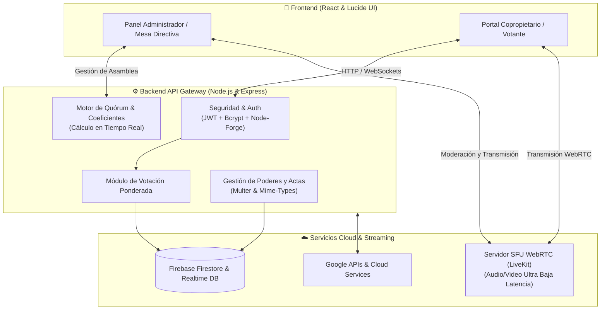

# 🏛️ RoLEMeet — Plataforma WebRTC para Asambleas de Propiedad Horizontal

> **RoLEMeet** es un ecosistema SaaS diseñado para transformar la toma de decisiones en copropiedades y entidades corporativas, eliminando el fraude en quórum, agilizando votaciones complejas y ofreciendo transmisión de audio/video en tiempo real con ultra baja latencia.

🔗 **Plataforma en Producción:** [rolesaas.com/meet](https://rolesaas.com/meet/)  
💼 **Desarrollado por:** LR Reuniones y Asambleas / BYO Improvement  

---

## 📌 El Problema de Negocio

Las asambleas de propiedad horizontal enfrentan desafíos operacionales y jurídicos críticos:
1. **Falta de Validez Jurídica:** Votaciones manuales o por chat que carecen de trazabilidad y generan impugnaciones legales (Ley 675 de 2001).
2. **Cálculo Complejo de Quórum:** Computar coeficientes de copropiedad al milisegundo ante la llegada de nuevos asistentes o cesión de poderes.
3. **Fricción Tecnológica:** Plataformas tradicionales (Zoom/Teams) no están diseñadas para votaciones ponderadas por coeficiente ni control estricto de oradores.

---

## 🚀 Arquitectura y Capacidades Técnicas

## 📸 Vitrina Visual de la Plataforma

### 🗳️ Votación Ponderada en Tiempo Real

### 🖥️ Módulos de Operación, Control y Experiencia de Usuario

| Agenda del Conductor | Dashboard de Operaciones |
| :---: | :---: |
|  |  |
| **Gestión de orden del día y tiempos** | **Monitoreo operativo de la asamblea** |

| Expediente Digital | Portal del Participante (Móvil / Web) |
| :---: | :---: |
|  |  |
| **Trazabilidad documental y actas** | **Interfaz accesible para copropietarios** |

| Equipo, Roles y Permisos | Votación y Transcripción en Vivo |
| :---: | :---: |
|  |  |
| **Control de mesa directiva y moderadores** | **Registro automatizado de intervenciones** |

🛡️ Módulos de Ingeniería Destacados

1. Seguridad Criptográfica y Validez Legal
Autenticación sin Estado (Stateless Auth): Implementación de tokens firmados mediante jsonwebtoken (JWT) con hashing de credenciales en bcrypt.
Integridad Criptográfica: Uso de node-forge para la verificación criptográfica y firma digital de actas y resultados de votación, blindando las decisiones contra repudiación jurídica.
2. Infraestructura de Medios en Tiempo Real (LiveKit / WebRTC)
Despliegue de salas con arquitectura SFU (Selective Forwarding Unit) para transmisión fluida de video y audio optimizada para redes móviles inestables.
Control dinámico de silenciamiento de micrófonos, asignación de turnos de palabra y oradores principales para evitar el caos típico de asambleas numerosas.
3. Motor de Quórum y Votación por Coeficiente
Registro algorítmico de asistencia con ponderación por coeficiente de propiedad horizontal hasta 4 decimales.
Publicación instantánea de resultados gráficos para los asambleístas.
4. Gestión de Poderes y Acreditación Documental
Pipeline de subida, validación de tipos MIME y procesamiento de poderes notariales mediante multer.

💡 El Viaje de Creación (Founder Journey)
RoLEMeet no es un proyecto de laboratorio; es el resultado de más de 435 días de desarrollo continuo, pruebas en asambleas reales y evolución técnica.
Filosofía de Producto: Diseñar una herramienta que una persona de 80 años pueda operar desde su teléfono móvil sin frustración, al tiempo que le entrega al revisor fiscal y al administrador un soporte jurídico inalterable.
Modelo Operativo: Arquitectura moderna basada en microservicios, APIs desacopladas y servicios de tiempo real en la nube.

👨‍💻 Autor & Arquitectura de Producto
Jean Michell Leguizamón Romero
Magíster en Gerencia Estratégica de Mercadeo | Fundador y Desarrollador de Producto
LinkedIn
Sitio Oficial RoLEMeet
Contacto: lrreunionesyasambleas@gmail.com